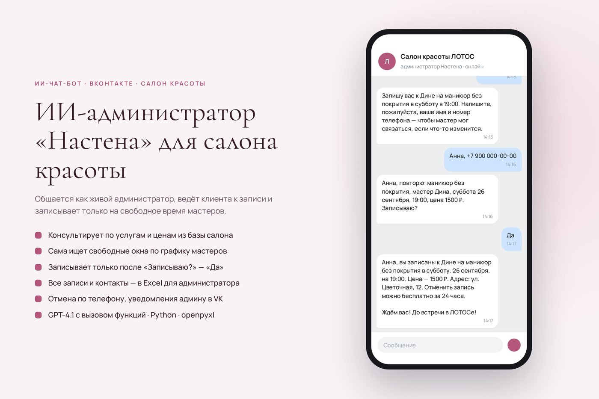
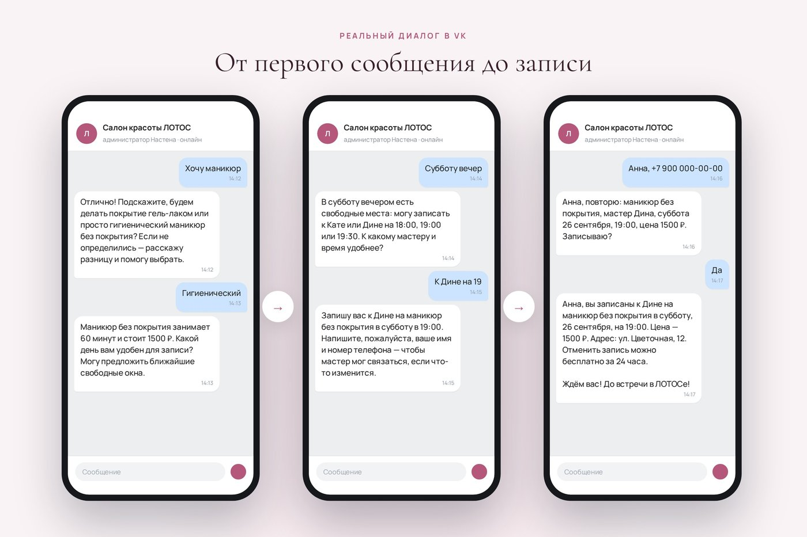
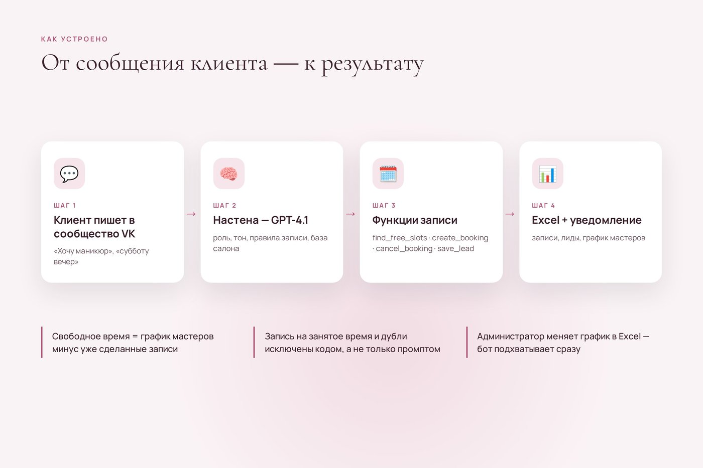
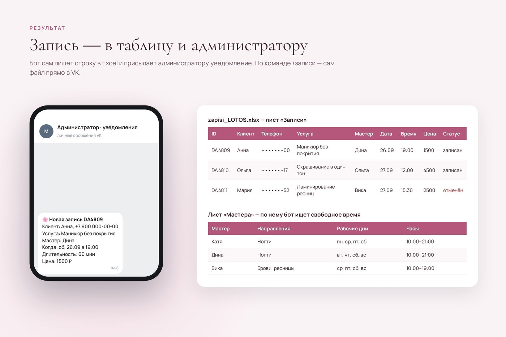
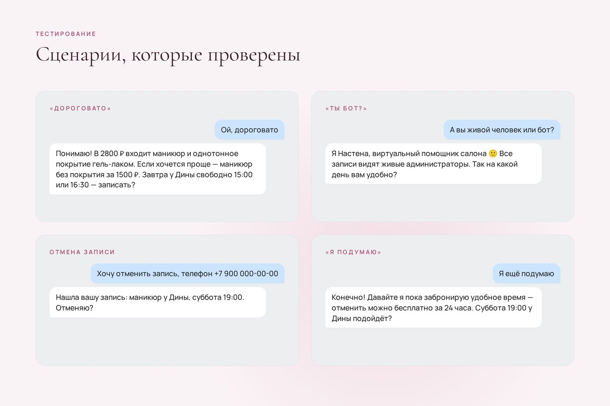

# Настена — ИИ-администратор салона красоты «ЛОТОС» во ВКонтакте

Чат-бот для сообщений сообщества VK: общается как живой администратор, ведёт клиента к записи, сам находит свободное время мастеров и записывает в Excel-таблицу. GPT-4.1 с вызовом функций, Python.



## Для кого и какую задачу решает

Для салонов красоты, барбершопов, студий маникюра и любого бизнеса с записью к мастерам, где клиенты пишут в сообщения сообщества VK.

Администратор не успевает отвечать: клиент спрашивает цену вечером или в выходной, ждёт ответа несколько часов и уходит в другой салон. Настена отвечает сразу и круглосуточно, рассказывает об услугах, предлагает 2–3 конкретных окна и доводит разговор до записи. Администратору остаётся получить уведомление и открыть таблицу.

## Что умеет

- **Консультирует по базе услуг** — цены, длительность, правила, частые вопросы берутся только из базы салона (`kb_data.py`). Чего нет в базе, бот не придумывает.
- **Сама ищет свободное время** — по графику мастеров (лист «Мастера» в Excel) минус уже сделанные записи, шаг 30 минут, не раньше чем через час от текущего момента и не дальше 14 дней вперёд.
- **Записывает только после подтверждения** — повторяет услугу, мастера, дату, время и цену, спрашивает «Записываю?» и пишет в таблицу только после «да». Правило есть в промпте, и оно же проверяется в коде: без «да» на вопрос бота функция записи вернёт отказ.
- **Ведёт таблицу Excel** — листы «Записи», «Лиды» (контакты тех, кто пока не записался, и жалобы), «Мастера», «Услуги». Администратор может поменять график прямо в таблице, бот подхватит его при следующем подборе времени.
- **Уведомляет администратора в VK** — о каждой новой записи, отмене и новом контакте. По команде `/записи` присылает администратору сам файл Excel.
- **Отменяет запись** — по телефону клиента, и только его собственную: запись, сделанную с другого VK-аккаунта, бот не отменит.
- **Защита от двойной записи** (в коде, а не только в промпте):
  - перед записью время заново проверяется по графику и всем активным записям мастера; если слот уже занят или пересекается с другой процедурой, бот предложит другое время;
  - повторный вызов с тем же телефоном, мастером, датой и временем не создаёт дубль, а возвращает уже существующую запись;
  - время «из головы» не принимается, только из найденных свободных окон.
- **Отрабатывает возражения** — «дорого», «подумаю», «неудобно время»; после двух отказов не давит, а предлагает оставить контакт.
- **Честно отвечает, что она виртуальный помощник**, если её прямо об этом спросить.
- **Догоняет пропущенное** — после перезапуска отвечает на сообщения, оставшиеся без ответа за последний час.

## Как устроено

```
Клиент пишет в сообщество VK
        │  VK Long Poll
        ▼
bot.py ── история диалога + системный промпт (роль, правила, база салона)
        │
        ▼
GPT-4.1 (function calling) ──► вызывает функции:
        │                       find_free_slots   — свободные окна мастеров
        │                       create_booking    — запись (проверки в коде)
        │                       find_my_bookings  — записи клиента по телефону
        │                       cancel_booking    — отмена
        │                       save_lead         — контакт без записи / жалоба
        ▼
data/zapisi_LOTOS.xlsx  ──►  уведомление администратору в VK
(Записи · Лиды · Мастера · Услуги)
```

Файлы:

| Файл | Что внутри |
|---|---|
| `bot.py` | бот: VK Long Poll, вызов модели, функции записи, работа с Excel |
| `system_prompt.md` | роль и правила Настены; при каждом сообщении в него подставляются дата, время и база знаний |
| `kb_data.py` | база салона: услуги и цены, мастера и график, FAQ, стандарты, тон |
| `test_dialog.py` | прогон сценария диалога в консоли без VK |
| `run.sh` | запуск/перезапуск в фоне, журнал в `data/bot.log` |
| `docs/knowledge_base_LOTOS.md` | та же база знаний в читаемом виде |

## Стек

- Python 3.9+ (только стандартная библиотека + `openpyxl`)
- VK API, Bots Long Poll
- GPT-4.1 с вызовом функций (function calling) через Proxy API или любой OpenAI-совместимый endpoint
- Excel через `openpyxl`

## Скриншоты

Диалог от первого сообщения до записи:



Схема работы:



Результат: строка в Excel и уведомление администратору:



Проверенные сценарии: «дорого», «ты бот?», отмена, «я подумаю»:



Видео диалога (40 секунд): [images/video-dialog.mp4](images/video-dialog.mp4)

На макетах вымышленная клиентка и демо-номер телефона.

## Запуск

### 1. Ключи

- **Ключ сообщества VK.** Сообщество → «Управление» → «Работа с API» → «Ключи доступа» → создать ключ с правами «сообщения сообщества», «документы» и «управление сообществом». Там же на вкладке «Long Poll API» включить Long Poll (версия 5.199) и в «Типах событий» отметить «Входящее сообщение». В «Сообщениях» сообщества включить сообщения и в настройках бота разрешить боту отвечать.
- **ID сообщества** — число из адреса `vk.com/club123456789`.
- **Ключ нейросети.** По умолчанию бот ходит в [Proxy API](https://proxyapi.ru) (доступ к моделям OpenAI из России), ключ — в личном кабинете. Можно напрямую в OpenAI: тогда в `.env` указать `AI_URL=https://api.openai.com/v1/chat/completions` и ключ OpenAI в `PROXYAPI_KEY`.
- **VK ID администратора** — кому слать уведомления. Свой ID можно узнать, написав боту `/id`. Несколько администраторов — через запятую. Администратор должен хотя бы раз написать в сообщество, иначе VK не даст боту отправить ему сообщение.

### 2. Установка и настройка

```bash
git clone https://github.com/permykov291281-sys/salon-lotos-bot.git
cd salon-lotos-bot
pip install -r requirements.txt
cp .env.example .env      # и вписать свои ключи
chmod 600 .env
```

### 3. Запуск

```bash
python3 bot.py --cli      # чат с Настеной в консоли, без VK (нужен только ключ нейросети)
python3 test_dialog.py    # прогон готового сценария: маникюр → «дорого» → время → имя и телефон → «да»
python3 bot.py            # работа в сообществе VK
./run.sh                  # то же в фоне, журнал в data/bot.log
```

При первом запуске создаётся `data/zapisi_LOTOS.xlsx` с листами «Записи», «Лиды», «Мастера», «Услуги». Часовой пояс задан в `bot.py` (`TZ = Asia/Yekaterinburg`).

Команды в чате: `/сброс` — очистить историю диалога, `/id` — узнать свой VK ID, `/записи` — получить таблицу (только администратор).

### Под свой салон

Отредактировать `kb_data.py` (услуги, цены, мастера, график, FAQ) и при желании тон в `system_prompt.md`. Если таблица уже создана, график мастеров меняется прямо в листе «Мастера».

## Демо-данные

Салон «ЛОТОС» — учебный проект. FAQ, стандарты и тон собраны из учебных баз знаний курса; мастера, их график, адрес («ул. Цветочная, 12») и часть цен придуманы.

---

Разработка — вайб-кодинг в Claude Code.
